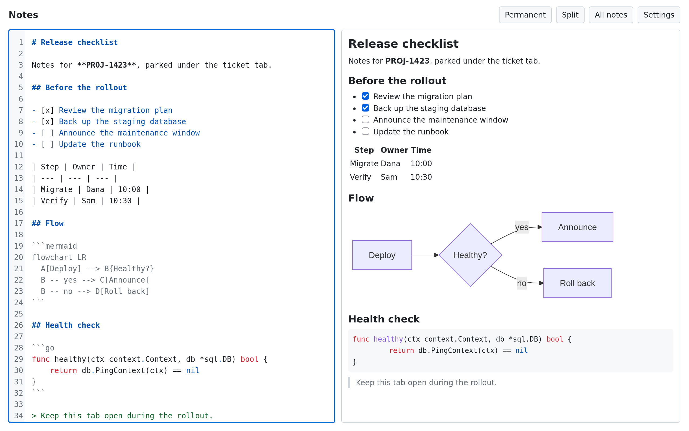
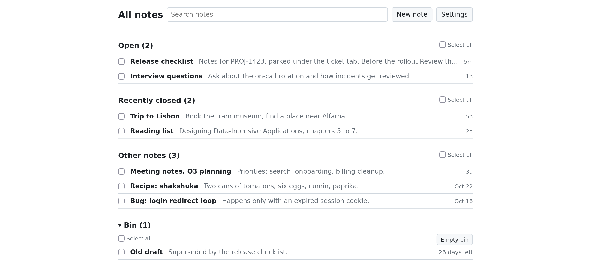
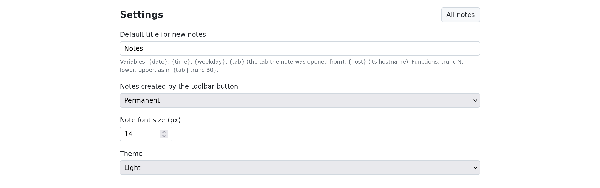

#  tabnotes

Markdown notes that live in your Firefox tabs. Click the toolbar button and a note opens as a tab, right next to the page it belongs to. Keep a note under a ticket, a document or a [Sidebery](https://addons.mozilla.org/firefox/addon/sidebery/) group, and it stays there, even after you restart Firefox.

<picture>
  <source media="(prefers-color-scheme: dark)" srcset="docs/screenshots/note-dark.png">
  
</picture>

## Features

- **Notes as tabs.** Each note is a normal tab, nested under the tab you opened it from if you use Sidebery.
- **Editor and live preview.** Work side by side, or show only one of the two. Everything saves as you type.
- **Titles from templates.** Rename a note from its header, or build titles from the date and the tab you came from.
- **Rich previews.** Task lists you can tick, tables, highlighted code with a Copy button, and [Mermaid](https://mermaid.js.org/) diagrams.
- **Images.** Drop or paste images into a note, up to 25 MB each.
- **All notes.** Search, reopen and tidy up every note in one place, including tabs you closed.
- **A bin.** Deleted notes stay for 30 days before they are removed, 7 if a temporary note moved there by itself.
- **Permanent and temporary notes.** A temporary note you have closed moves to the Bin after 30 days. A permanent note stays until you delete it.
- **Light and dark.** Follow your system or pick one.
- **Private.** Notes stay in this Firefox on this device. The extension makes no network requests.

## Install

You need Firefox 143 or newer.

1. Open the [latest release](https://github.com/Semior001/tabnotes/releases/latest) and click the `.xpi` file.
2. Confirm the install. If Firefox only downloads the file, open `about:addons`, click the gear menu, choose "Install Add-on From File..." and pick the file.

Updates are not automatic: install each new version the same way. Your notes stay in place.

The extension asks for these permissions:

| Permission | Why |
| --- | --- |
| `storage` | Keep your notes and images in Firefox |
| `tabs` | Open note tabs, find the ones already open, and read the title and address of the tab a note was opened from for `{tab}` and `{host}` |
| `sessions` | Restore note tabs you closed |

## Using tabnotes

### Write a note

Click the tabnotes button in the toolbar. Type markdown on the left and see the result on the right. Press `Ctrl+E` (`Cmd+E` on Mac) to switch between both panes, the editor only and the preview only.

The preview works too:

- Click a checkbox to tick the task.
- Hover over a code block to copy it.
- Double-click a block to jump to it in the editor.
- Click a link to open it in a new tab.

To add an image, drop it into the editor or paste it from the clipboard.

### Rename a note

Click the title in the note header, or focus it and press `Enter` or `Space`, then type a new one. `Enter` or clicking away saves it, and `Esc` cancels. The tab title changes with it. Close the tab before saving and the new title is lost, and a note with no text yet keeps its title only while the tab is open.

A title can hold variables and functions, and the page lists them while you rename. They are filled in once, when you save, so the title stays plain text afterwards:

| Variable | Value |
| --- | --- |
| `{date}` | Today, such as `2026-11-01` |
| `{time}` | The time, such as `14:05` |
| `{weekday}` | The day of the week, such as `Sunday` |
| `{tab}` | The title of the tab the note was opened from |
| `{host}` | The hostname of that tab, such as `github.com` |

| Function | Effect |
| --- | --- |
| `trunc N` | Cut to at most N characters, including the `…` |
| `lower` | Lower case |
| `upper` | Upper case |

Functions follow the variable after a `|`, and each works on the result of the one before. On a tab titled "Fix the login redirect on mobile Safari", `{date} - {tab | trunc 30}` gives `2026-11-01 - Fix the login redirect on mob…`.

`{tab}` and `{host}` are empty if the note was not opened from a tab, as with the new note buttons in All notes, or if that tab has since closed, and `{host}` is empty for anything but a web page. Text around an empty variable stays, so `{date} - {tab | trunc 30}` gives `2026-11-01 -` with no tab, and `{tab} - {host}` gives `-`. Text in braces that is not a known variable and function stays as you typed it.

### Find your notes

Open **All notes** from the header of any note. Notes are grouped into Open, Recently closed, Other notes and Bin. Click a row to go to the note, reopen its tab or restore it along with its window. "New permanent note" and "New temporary note" open an empty note of that kind.

<picture>
  <source media="(prefers-color-scheme: dark)" srcset="docs/screenshots/all-notes-dark.png">
  
</picture>

Press `/` to search. Tick rows, or Shift-click a range, to move several notes to the Bin at once or to change their kind. "Undo" brings moved notes back, but not their tabs.

### Delete and restore

"Move to Bin" closes the note's tabs and keeps the note for 30 days. Open the Bin section in All notes to restore it or delete it forever.

### Permanent and temporary notes

A permanent note is kept until you delete it. A temporary note moves to the Bin by itself after it has been closed for 30 days, and is deleted 7 days later. Editing the note restarts the 30 days. Notes from earlier versions are permanent.

The toolbar button creates the kind chosen in Settings, permanent by default. To change a note's kind, click **Permanent** or **Temporary** in its header, use "Make temporary" or "Make permanent" on its row in All notes, or tick several rows. A note in the Bin keeps its kind, which you can change after restoring it.

All notes marks temporary notes, and shows the days left on the ones that are closed. A temporary note restored from the Bin stays temporary, and its 30 days start again. "Move to Bin" keeps a note for 30 days, whatever its kind.

### Settings

Choose the default title for new notes, the kind of note the toolbar button creates, the font size for all notes, and the theme. The default title can hold the same variables and functions as a rename, filled in when a note is created.

<picture>
  <source media="(prefers-color-scheme: dark)" srcset="docs/screenshots/settings-dark.png">
  
</picture>

## Keyboard shortcuts

Use `Cmd` instead of `Ctrl` on Mac.

| Keys | Action |
| --- | --- |
| `Ctrl+E` | Switch between split, editor and preview (does nothing while renaming) |
| `Enter` or `Space` on the note title | Rename the note |
| `Ctrl+B` | Bold |
| `Ctrl+I` | Italic |
| `Ctrl+K` | Insert a link |
| `Ctrl+F` | Find |
| `Ctrl+G` / `Shift+Ctrl+G` | Next / previous match |
| `Shift+Ctrl+F` | Replace (`Cmd+Alt+F` on Mac) |
| `Ctrl+=` / `Ctrl+-` / `Ctrl+0` | Larger / smaller / default font size |
| `/` on All notes | Search |
| `Esc` on All notes | Clear the selection |

## Good to know

- **Removing the extension deletes your notes.** Notes are stored inside the extension, and there is no sync or export. They do not move to another device or Firefox profile.
- Remote images, such as ``, do not load. Add the image to the note instead.
- HTML in a note is shown as plain text.
- A deleted image still takes up space for at least 7 days, so you can undo the change.
- Temporary notes are checked only while Firefox is running, so one can stay past its 30 days until Firefox has been running for 10 minutes.
- Keep a note open if it shows a save error, for example when storage is full. Closing the tab loses the unsaved text.

## Development

Building, testing and releasing are covered in [docs/DEVELOPMENT.md](docs/DEVELOPMENT.md).

## License

[MIT](LICENSE). The packaged extension includes third-party code, listed with its licenses in `THIRD_PARTY_LICENSES.txt` at the root of the `.xpi`.
